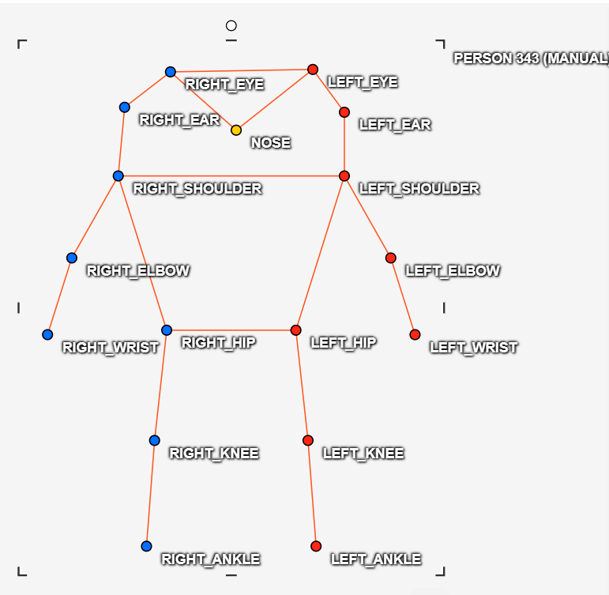
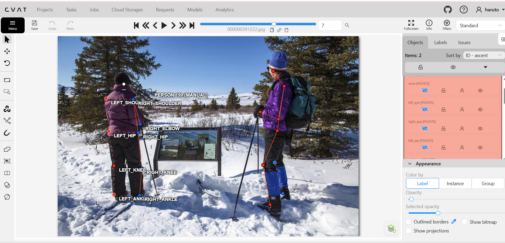
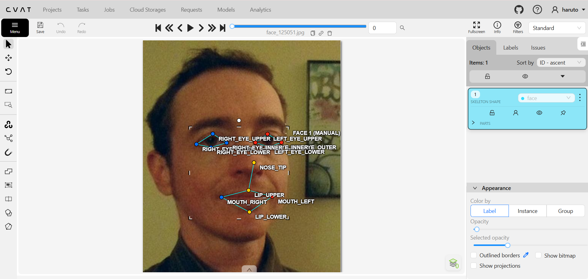
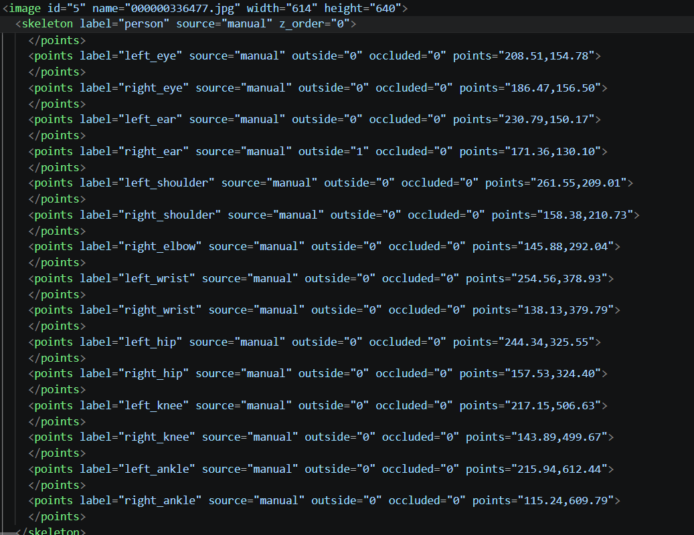

# Báo cáo cá nhân — HoVaTen-MSSV

Đổi tên file theo quy tắc `MSSV_HoTen.md`. Ví dụ: `20241234_NguyenVanAn.md`.

Dữ liệu: 12 ảnh người COCO val2017 (Lin et al., 2014) và 8 ảnh chân dung Wikimedia Commons, chỉ dùng trong lớp.

## 0. Thông tin học viên

- Họ tên: Nguyễn Minh Hiếu 
- MSSV: 2A202603169  
- Email: 26ai.hieunm12@vinuni.edu.vn
- Link repository: 
- Phiên bản CVAT (Help → About): Server version: 2.74.1, UI version: 2.74.1
- Máy: hệ điều hành Windows 11 · RAM 16 GB · chạy CVAT chế độ lite
- Bộ ảnh (`src/exports/assignment.json` do `lab.py setup` tạo): có 
- Giờ bắt đầu: 5h
- Giờ kết thúc:6h50

## 1. Kiểm tra label (CP0)

| Label | Kiểu | Số điểm | Tên điểm đúng bảng của lab? | Đúng thứ tự? | Số cạnh |
|---|---|---:|---|---|---:|
| `person` |Skeleton |17 |có |có |19 |
| `face` |Skeleton |13 |có |có |13 |

Mẫu `person` dựng theo người quay mặt về camera (các điểm `left_*` nằm bên phải khung mẫu)? Có 

Cách đổi cờ `occluded` / `outside` cho **một điểm** trên phiên bản CVAT này (một câu): chọn keypoint rồi nhấn phím Q/O

...

## 2. Số lượng đã gán và thời gian (CP1, CP2)

| Nhóm ảnh | Số ảnh | Số skeleton đã gán | Số người dưới 60 px (không gán) | Số poster / gương / màn hình bỏ qua | Thời gian (phút) |
|---|---:|---:|---:|---:|---:|
| `easy` | 5 |5 |0 |1 |30 |
| `occluded` | 3 |6 |0 |0 |45 |
| `back` | 3 |4 |0 |0 |20 |
| `small` | 1 |1 |0 |0 |17 |
| `crowd` | 1 |2 |không xác định do quá bé và ở trên khán đài |0 |10 |
| `faces` | 8 |8 | — |0 |25 |

- Số ảnh người đã xong ở mốc phút 105: _9__ / 10
- Thời gian thực tế (phút): CP1 122 · CP2 25 · CP3 60
- Ảnh tốn thời gian nhất là ảnh nào, vì sao?
 Là nhóm ảnh  `occlude` vì phải kiểm tra kĩ các keypoint bị che khuất xem có đoán được không

## 3. Bảng ca khó (CP1, CP2)

Mỗi điểm bạn phân vân một dòng, nhất là phân vân giữa `v = 1` và `v = 0`, hoặc không chắc hướng người.

| Ảnh | Người / mặt | Điểm | Cờ đã chọn | Phân vân giữa | Lý do chọn |
|---|---|---|---:|---|---|
| | | | | | |
| | | | | | |
| | | | | | |

## 4. Bảng tự review (CP3)

Đi từ ảnh cuối về ảnh đầu. 5 ảnh người (ít nhất 2 ảnh `back` hoặc `crowd`) và 3 ảnh mặt. Ít nhất 8 dòng, kể cả dòng `ok`. Ghi lỗi trước, sửa sau.

Mã lỗi dùng đúng một trong: `lr_swap`, `vis_flag`, `position`, `missing`, `extra`, `ok`.

| Ảnh | Người / mặt | Điểm | Mã lỗi | Ghi chú | Đã sửa? |
|---|---|---|---|---|---|
|000000130816 |Người(crowd) |right/left_shoulder |lr_swap |Hai điểm trái phải bị đảo |có |
|000000189365 |Người |right_elbow |vis_flag |khuỷu tay phải bị che khuất nhưng đặt v=2 thay vì v=1 |có |
|000000336477 |Người |Right ankle |ok |Điểm đặt đúng vị trí, visibility phù hợp |không |
|000000391222 |Người(back) |right hip |position |đặt lệch vị trí hông phải |có |
|000000433787 |Người |nose |missing |chưa đánh điểm mũi |có |
|face_13874 |Mặt |nose tip |ok |đặt đúng vị trí chóp mũi |không |
|face_41666 |Mặt |right eye inner |position |đặt lệch vị trí quá đà sang sống mũi |có |
|face_125051 |Mặt |4 điểm vùng left eye |vis_flag |do đeo kính râm nên vùng mắt bị che hoàn toàn, flag nên là v=0 thay vì v=1 |có |

Tổng hợp số lỗi theo mã:

| `lr_swap` | `vis_flag` | `position` | `missing` | `extra` | `ok` |
|---:|---:|---:|---:|---:|---:|
|1 |2 |1 |2 |0 |2 |

Điểm còn phân vân giữa `v = 1` và `v = 0` (ghi cả hai lựa chọn và lý do chọn):

...

## 5. Kiểm file xuất và kết quả tự kiểm (CP4)

Tự kiểm tay trong file JSON:

| File | Người / mặt kiểm (ảnh, thứ tự) | Số phần tử `keypoints` | Điểm `outside` ra `v = 0`, `occluded` ra `v = 1`? | `num_keypoints` khớp? |
|---|---|---:|---|---|
| `HoVaTen_persons.zip` |Person |17 |Có dấu hiệu đúng |có |
| `HoVaTen_faces.zip` |Face |13 |có dấu hiệu đúng |có |

Sau khi xuất, CVAT ghi `occluded` thành `v = 1` và `outside` thành `v = 0`. Tọa độ của điểm `outside` trong file là `0, 0` hay tọa độ cũ? vẫn giữ tọa đọ cũ

Hai job đã chuyển sang completed trên CVAT? Có 

Dán phần **TÓM TẮT** in ra từ `src/check_submission.py`:

```text
=== src\exports\NguyenMinhHieu_persons.zip (label `person`) ===
  [CẢNH BÁO] 000000343057.jpg #1: cặp knee nằm ngược phía so với các cặp còn lại. Có thể đổi trái/phải một cặp (`lr_swap`), hoặc tay / chân bắt chéo thật: kiểm lại.
  [CẢNH BÁO] 000000431988.jpg #2: `left_wrist` v = 2 nằm sát mép ảnh (374, 181). Nếu khớp thật ở ngoài ảnh, bật outside thay vì kéo về mép.

=== src\exports\NguyenMinhHieu_faces.zip (label `face`) ===

----- TÓM TẮT (dán vào báo cáo mục 5) -----
- File person: NguyenMinhHieu_persons.zip
  Số ảnh: 12 · số skeleton `person`: 19 · mỗi annotation 51 số
  Skeleton theo ảnh: 000000100510=2, 000000130816=2, 000000156986=2, 000000175703=1, 000000189365=2, 000000336477=1, 000000343057=1, 000000391222=2, 000000431988=2, 000000433787=1, 000000469061=2, 000000525227=1
  Cờ v: v=2 195 (60%) · v=1 30 (9%) · v=0 98 (30%)
  num_keypoints trung bình: 11.8
- File face: NguyenMinhHieu_faces.zip
  Số ảnh: 8 · số skeleton `face`: 8 · mỗi annotation 39 số
  Skeleton theo ảnh: face_125051=1, face_137371=1, face_13874=1, face_145751=1, face_415073=1, face_41666=1, face_469647=1, face_504911=1
  Cờ v: v=2 90 (87%) · v=1 4 (4%) · v=0 10 (10%)
  num_keypoints trung bình: 11.8
- Ghi chú: 108 điểm v = 0 vẫn mang tọa độ cũ (CVAT 2.x xuất như vậy; chuẩn COCO ghi 0, 0). Không phải lỗi: điểm v = 0 bị bỏ qua khihuấn luyện và khi chấm.
- Số [LỖI]: 0 · số [CẢNH BÁO]: 2
Kết quả: ĐẠT (đọc lại từng cảnh báo ở trên)
```

Các `[CẢNH BÁO]` còn giữ nguyên và lý do:
[CẢNH BÁO] 000000343057.jpg #1: cặp knee nằm ngược phía so với các cặp còn lại. Có thể đổi trái/phải một cặp (`lr_swap`), hoặc tay / chân bắt chéo thật: kiểm lại.
  [CẢNH BÁO] 000000431988.jpg #2: `left_wrist` v = 2 nằm sát mép ảnh (374, 181). Nếu khớp thật ở ngoài ảnh, bật outside thay vì kéo về mép.

Lí do: theo hướng nhìn và giải phẫu học, cặp knee đã nằm đúng hướng và cổ tay nằm đúng vị trí 

## 6. Ảnh chụp màn hình

1. Label `person` trong label constructor (đủ 17 điểm có tên):

   

2. Một người quay lưng đã gán, cờ đã đặt:

   

3. Một khuôn mặt đã gán 13 điểm, phóng to vùng mắt:

   

4. Một đoạn JSON xuất của một người:

   

Nguồn ảnh: COCO val2017 / Wikimedia Commons.

## 7. Tự đánh giá

1. Lỗi bạn mắc nhiều nhất hôm nay, và cách bạn sẽ tránh ở dự án thật:

- Lỗi tôi mắc nhiều nhất hôm nay là đặt keypoint chưa chính xác, đặc biệt ở những vị trí bị che khuất hoặc khó xác định như khuỷu tay, cổ tay và các điểm trên khuôn mặt. Đôi khi tôi đặt điểm theo suy đoán thay vì dựa trên những đặc điểm thực sự quan sát được.
- Để tránh lỗi này trong dự án thực tế, tôi sẽ kiểm tra kỹ từng keypoint, sử dụng đúng thứ tự điểm theo schema, đối chiếu với guideline và không tự suy đoán vị trí của những điểm không nhìn thấy.

2. Một quy tắc bạn đề xuất thêm vào guideline (kèm ảnh ví dụ nếu có):

   ...

3. Nhãn của bạn đi vào model ở đâu? Chọn một lỗi bạn đã sửa và nói nó sẽ làm model học sai thế nào (heatmap, trọng số trong loss, hay bước lật ảnh):

Nhãn Keypoint Annotation được sử dụng trong quá trình huấn luyện mô hình Pose Estimation.

Các tọa độ keypoint đã gán sẽ được chuyển thành heatmap để mô hình học cách dự đoán vị trí của từng điểm trên cơ thể.

Ví dụ, nếu tôi đặt sai vị trí keypoint cổ tay, heatmap được tạo ra cũng sai theo. Khi huấn luyện, mô hình sẽ học vị trí mục tiêu không chính xác, khiến khả năng dự đoán keypoint trên ảnh thực tế giảm xuống.

Vì vậy, annotation chính xác rất quan trọng vì dữ liệu gán nhãn chính là cơ sở để mô hình học và đánh giá kết quả.

## 8. Khó khăn và lỗi kỹ thuật

...

## Bonus (nếu làm)

### B1 — 3 ảnh người khó thêm

| Ảnh | Số skeleton | Số người dưới 60 px | Ca khó nhất |
|---|---:|---:|---|
| | | | |
| | | | |
| | | | |

Kết quả `src/check_submission.py` cho `HoVaTen_bonus_persons.zip`:

```text
(dán ở đây)
```

### B2 — 5 ảnh khuôn mặt đen trắng / hồng ngoại

Ảnh không màu khó hơn ở điểm nào? Kính râm trên ảnh hồng ngoại có còn là `v = 1` không?

...

### B3 — Model so với nhãn của tôi (không tính điểm)

- Demo đã dùng:
- Ảnh đã thử:

1. Model có trả điểm cho khớp bị che, hay khớp ngoài ảnh không? Confidence ở các điểm đó thế nào?

   ...

2. Với người quay lưng, model có đổi trái/phải không?

   ...

3. Bộ điểm của model có giống 17 điểm COCO không?

   ...

## 9. Tài liệu tham khảo và công cụ AI đã dùng

chatgpt để tra ý nghĩa mã lỗi
